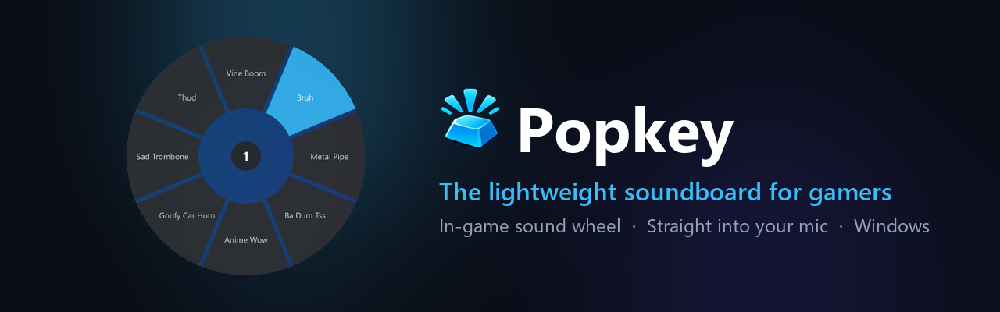
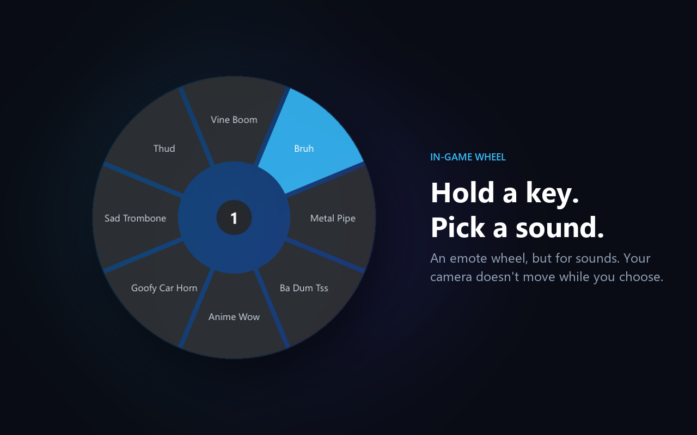
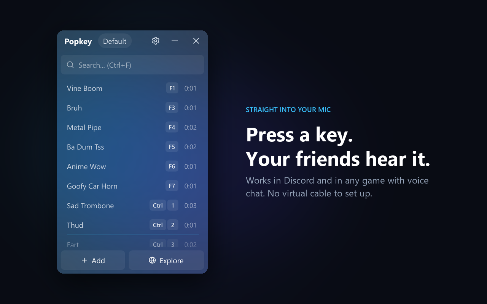
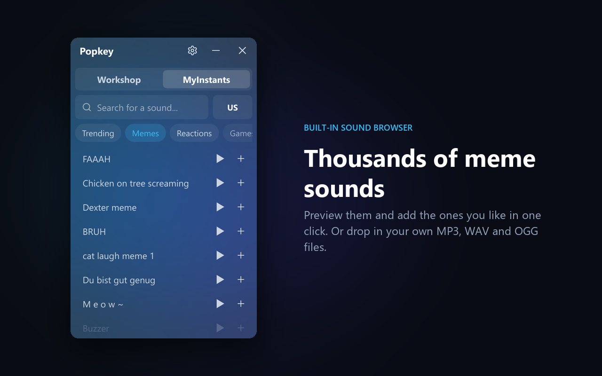
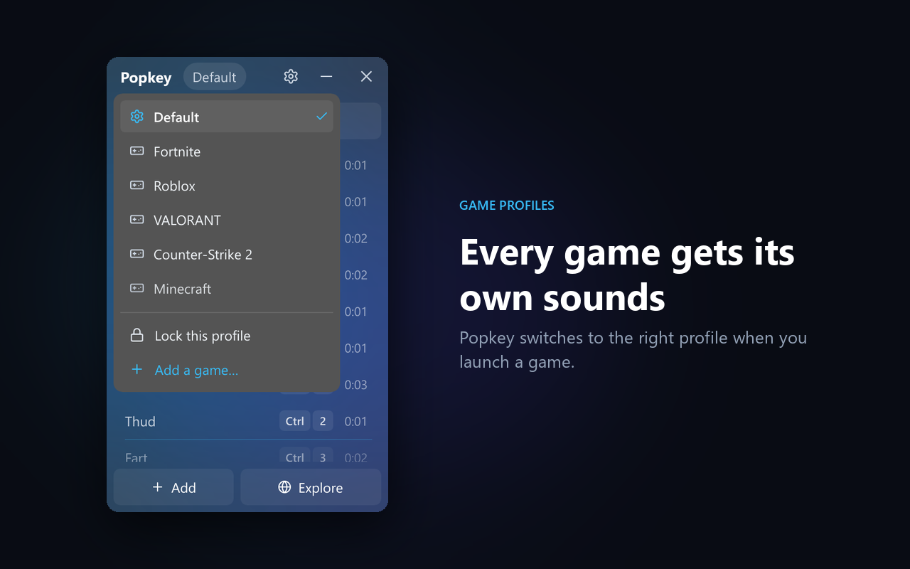

  

  *Press a key. Everyone in the call hears it.*

  
  
  
  
  

  [Download](#download) • [Features](#features) • [Install](#install) • [Demo vs full](#demo-vs-full-version) • [FAQ](#faq)

**Popkey** is a small Windows soundboard that plays sounds straight into your microphone, so everyone in your Discord call or in-game voice chat hears them. No virtual audio cable to set up. Hold a key in game and an emote-style wheel lets you pick a sound without moving your camera.

## Download

**[Get Popkey on itch.io](https://jeremyhot.itch.io/popkey)**: free demo and full version.

> [!NOTE]
> This repository only hosts the **free demo** update files. Popkey checks it to know when a new version is out. The source code is not public.

## Features

- **Straight into your mic:** works with Discord and any game with voice chat (Roblox, Fortnite, Valorant, CS2...). One click to enable, no virtual cable.
- **In-game sound wheel:** hold a key, flick your mouse toward a sound, let go. Your camera stays still while the wheel is open.
- **Game profiles:** each game gets its own sounds and shortcuts, switched automatically when you launch it.
- **Built-in sound browser:** preview meme sounds and add one in a click, or drop in your own MP3, WAV or OGG files.
- **Light:** about 9 MB installed, starts in well under a second, a few MB of RAM.
- **Stays out of your games:** no code injection, nothing hooked into the game.
- **English & French** interface, installer in 30 languages.

  
  
  
  

## Install

1. Download `Popkey-Setup.exe` (or `Popkey-Demo-Setup.exe`) from [itch.io](https://jeremyhot.itch.io/popkey) and run it. No admin rights needed.
2. The first time, Windows asks if Popkey can add itself to your microphone: click **Yes**.
3. Press **F1** to try a sound, or hold **F6** in game to open the wheel.

> [!TIP]
> Windows SmartScreen may say it "protected your PC" because Popkey is new and not code-signed yet. Click **More info → Run anyway**.

To uninstall: **Windows Settings → Apps → Popkey → Uninstall**. It also removes the microphone module, and asks whether to keep your sounds.

## Demo vs full version

| | Free demo | Full version |
| :--- | :---: | :---: |
| Sounds per profile | 8 | Unlimited |
| Sound wheel pages | 1 | Unlimited |
| Every other feature | ✅ | ✅ |
| Updates | Automatic | In-app notice, download from itch.io |

## FAQ

**Q: Can I get banned for using Popkey in online games?**  
A: Popkey never touches game files or memory. Sounds go through your normal Windows microphone, like talking. Follow each game's voice chat rules.

**Q: My friends can't hear the sounds.**  
A: Click **Enable** in the "Your friends can't hear your sounds" banner and accept the Windows prompt. If you use Discord's noise suppression (Krisp), set it to *Standard* or *None*: it can cut sound effects.

**Q: Does it work on Windows 10?**  
A: Yes. The see-through glass look needs Windows 11; on Windows 10 Popkey uses a solid background.

## License

Popkey is proprietary software. The demo is free to download and use. See [LICENSE](LICENSE).

---
*Made by Jeremy Bourret. Found a bug or have an idea? Leave a comment on [itch.io](https://jeremyhot.itch.io/popkey).*
